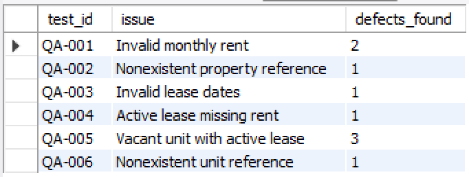

# Apartment Leasing Data Quality Audit

**SQL | MySQL Workbench | Data Quality Assurance | Data Validation**

## Project Overview

This project demonstrates the use of SQL to identify, investigate, and summarize data quality issues in a fictional apartment leasing database.

The database simulates property management records, including apartment properties, individual rental units, and tenant leases.

The objective was to apply business rules to detect inconsistent, missing, and invalid data that could affect reporting accuracy and operational decisions.

## Project Objectives

- Build a relational database using MySQL.
- Create and populate tables with synthetic apartment leasing records.
- Introduce intentional data quality issues for testing.
- Develop SQL queries to validate records against defined business rules.
- Identify potential data integrity and occupancy inconsistencies.
- Summarize findings in a consolidated QA report.

## Database Structure

The database contains three tables:

| Table | Description |
|---|---|
| `properties` | Property information, including location and total units |
| `units` | Apartment details, rental prices, and occupancy status |
| `leases` | Tenant information, lease dates, rental amounts, and lease status |

## Data Quality Tests

Six SQL validation tests were developed and executed.

| Test ID | Data Quality Issue | Findings |
|---|---|---|
| QA-001 | Invalid monthly rent | 2 |
| QA-002 | Nonexistent property reference | 1 |
| QA-003 | Invalid lease dates | 1 |
| QA-004 | Active lease missing rent | 1 |
| QA-005 | Vacant unit with active lease | 3 |
| QA-006 | Nonexistent unit reference | 1 |
| **Total** | **Flagged test results** | **9** |

All six queries successfully identified the expected data quality conditions. The occupancy check identified three potential conflicts requiring further investigation.

The nine findings represent flagged test results, not necessarily nine unique records.

## QA Summary Results

The summary report consolidates results from the six validation queries into a single output using SQL `UNION ALL`.

## SQL Techniques Demonstrated

- Relational database creation
- SQL `CREATE TABLE` and `INSERT INTO` statements
- `SELECT` and `WHERE` filtering
- `INNER JOIN` and `LEFT JOIN`
- `IS NULL` validation
- `COUNT()` aggregation
- Conditional business-rule testing
- `UNION ALL` reporting
- Data quality investigation and documentation

## Project Files

| File | Purpose |
|---|---|
| `01_database_setup.sql` | Create and select the project database |
| `02_create_tables.sql` | Define database tables and columns |
| `03_insert_data.sql` | Insert synthetic test records |
| `04_data_quality_tests.sql` | Execute six data quality validation tests |
| `05_qa_summary.sql` | Generate consolidated QA findings |

## How to Run

1. Open MySQL Workbench and connect to a MySQL server.
2. Run `01_database_setup.sql`.
3. Run `02_create_tables.sql`.
4. Run `03_insert_data.sql`.
5. Execute the queries in `04_data_quality_tests.sql`.
6. Run `05_qa_summary.sql` to generate the summary report.

The project uses fictional data created for educational and portfolio purposes.

## Key Takeaways

This project strengthened my understanding of how SQL can be used beyond data retrieval to validate data accuracy, investigate inconsistencies, and support quality assurance processes.

It also provided practical experience translating business requirements into repeatable validation queries and documenting results for review.

## Future Improvements

- Add additional validation scenarios and edge cases.
- Explore automated pass/fail testing.
- Introduce severity levels and defect prioritization.
- Develop a visual dashboard for data quality reporting.

---

**Author:** Alexandra Huston

**Tools:** MySQL, MySQL Workbench, GitHub
